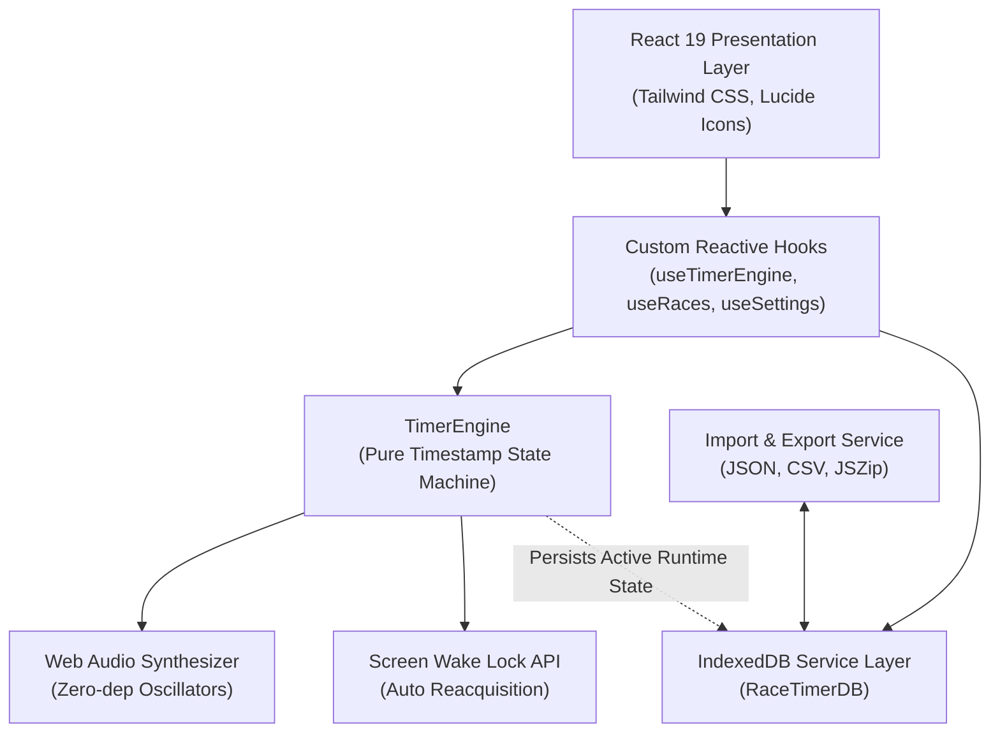
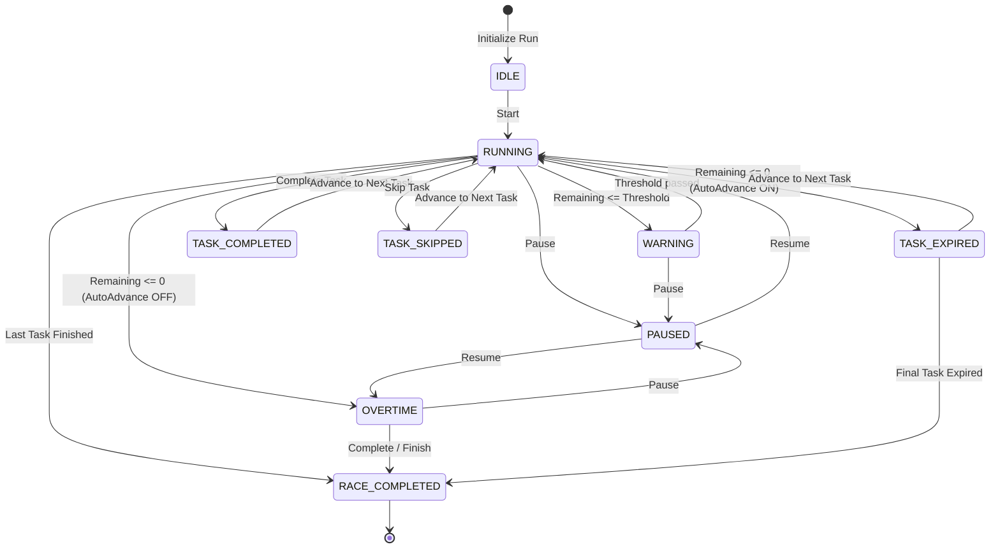
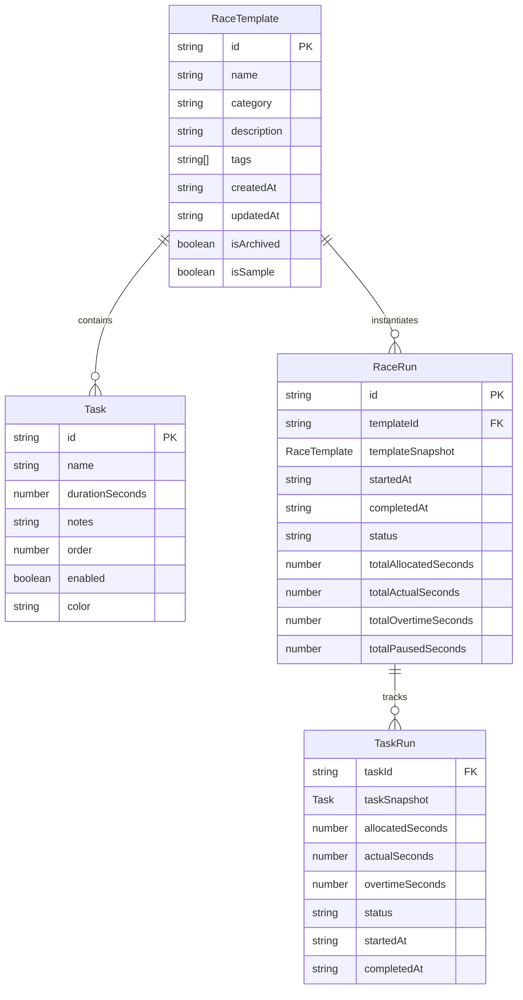
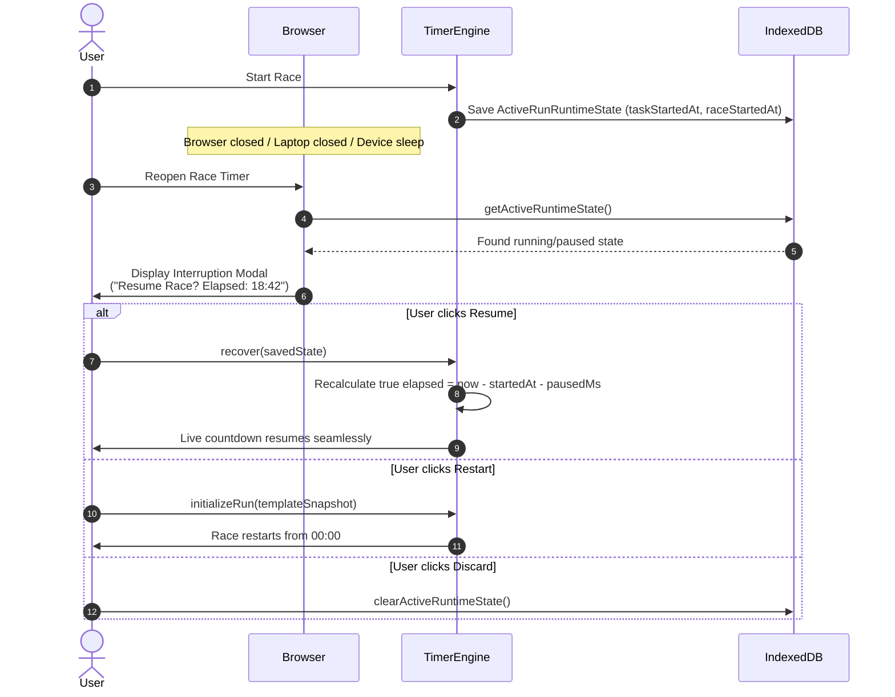

# Architecture Specification — Race Timer PWA

This document outlines the system architecture, state management principles, timer engine design, and local storage schema for **Race Timer**.

---

## 1. System Architecture Overview

---

## 2. Race State Machine

The timer transitions through well-defined, explicit operational states:

---

## 3. Separation of Concerns: Template vs. Run

One of the fundamental design decisions in Race Timer is treating a **Race Template** and a **Race Run** as decoupled entities:

### Why Snapshots Matter
When a user begins a race, a full deep snapshot of the template is embedded into `RaceRun.templateSnapshot`. If the user later edits the template's task durations or names, past historical runs remain immutable and authentic.

---

## 4. State Classification

The application strictly separates state into three tiers:

| Tier | Type | Storage | Examples |
| :--- | :--- | :--- | :--- |
| **Persistent State** | Domain entities | IndexedDB (`RaceTimerDB`) | Race templates, past runs, user settings, backup timestamps. |
| **Runtime State** | High-precision timers | In-Memory + Lightweight IDB sync | `taskStartedAt`, `taskPausedAt`, `raceAccumulatedPausedMs`, active task index. |
| **Derived State** | Computed on-the-fly | Reactive getters | `taskRemainingSeconds`, `progressPercent`, `isOvertime`, `estimatedFinishTime`. |

---

## 5. Interruption Recovery Architecture

When an active race is in progress, the engine periodically persists an `ActiveRunRuntimeState` into IndexedDB.

---

## 6. Offline PWA Strategy

- **Service Worker**: Generated via `vite-plugin-pwa` with Workbox caching.
- **Cache Strategy**: Pre-caches HTML, JS, CSS, SVG, and web fonts. Once loaded, the application operates 100% offline without needing an active internet connection.
- **Data Locality**: Zero external API endpoints, zero tracking scripts, zero hosted assets. All audio is synthesized on the fly via the browser's native `AudioContext`.
