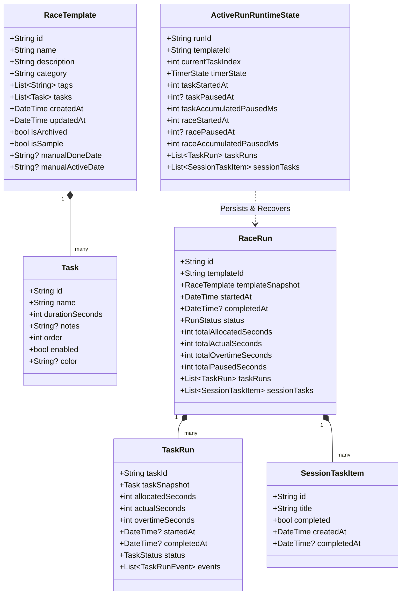
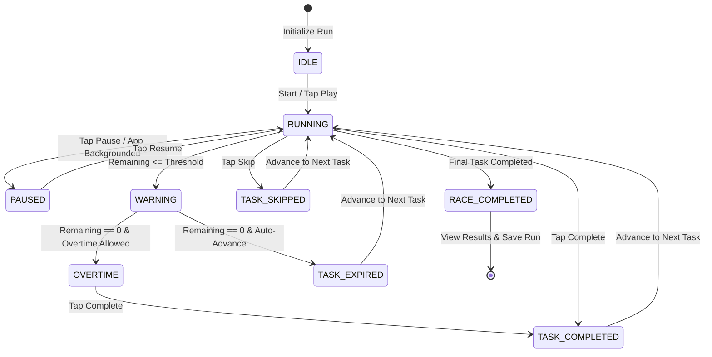
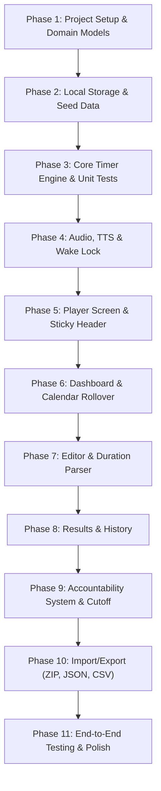

# Race Timer — Application Overview, Technical Specification & Flutter Architecture Guide

This document is the definitive technical specification and reference manual for the **Race Timer** application. It serves as an architectural blueprint for reimplementing the application natively in **Flutter for Mobile (iOS & Android)**.

---

## Table of Contents

1. [Executive Summary & Application Overview](#1-executive-summary--application-overview)
2. [Mental Model & Core Domain Concepts](#2-mental-model--core-domain-concepts)
3. [Exhaustive Feature Inventory & Implemented Behaviors](#3-exhaustive-feature-inventory--implemented-behaviors)
   - [3.1 Drift-Free Precision Timer Engine](#31-drift-free-precision-timer-engine)
   - [3.2 Dual Timers, Overtime & Pace Variance](#32-dual-timers-overtime--pace-variance)
   - [3.3 Crash & Interruption Recovery Machine](#33-crash--interruption-recovery-machine)
   - [3.4 Audio Synthesizer, Sound Cues & Text-to-Speech (TTS)](#34-audio-synthesizer-sound-cues--text-to-speech-tts)
   - [3.5 Screen Wake Lock & Focus Modes](#35-screen-wake-lock--focus-modes)
   - [3.6 In-Race Session Task Manager (Ad-Hoc Checklist)](#36-in-race-session-task-manager-ad-hoc-checklist)
   - [3.7 Race Dashboard & Daily Completion Rollover](#37-race-dashboard--daily-completion-rollover)
   - [3.8 Quick Start Launcher & Preset Workflows](#38-quick-start-launcher--preset-workflows)
   - [3.9 Template Editor & Intuitive Duration Parsing](#39-template-editor--intuitive-duration-parsing)
   - [3.10 Post-Race Performance Audit & Analytics](#310-post-race-performance-audit--analytics)
   - [3.11 Execution History & Apology Log](#311-execution-history--apology-log)
   - [3.12 Daily Cutoff & Interactive Accountability System](#312-daily-cutoff--interactive-accountability-system)
   - [3.13 Local Data Portability (ZIP, JSON, CSV Imports & Exports)](#313-local-data-portability-zip-json-csv-imports--exports)
   - [3.14 Resettable Seed Data System](#314-resettable-seed-data-system)
4. [Data Models & Schema Specification](#4-data-models--schema-specification)
5. [Timer Mathematical Formulation & State Machine](#5-timer-mathematical-formulation--state-machine)
6. [Flutter Mobile Architecture Blueprint](#6-flutter-mobile-architecture-blueprint)
   - [6.1 Recommended Project Structure](#61-recommended-project-structure)
   - [6.2 State Management with Riverpod](#62-state-management-with-riverpod)
   - [6.3 Local Persistence Strategy (Isar / Drift / Hive)](#63-local-persistence-strategy-isar--drift--hive)
   - [6.4 Audio, TTS & Wake Lock Mobile Implementation](#64-audio-tts--wake-lock-mobile-implementation)
   - [6.5 Mobile Background Execution & Lifecycle Handling](#65-mobile-background-execution--lifecycle-handling)
   - [6.6 UI & Widget Architecture](#66-ui--widget-architecture)
   - [6.7 Data Import / Export for iOS & Android](#67-data-import--export-for-ios--android)
7. [Step-by-Step Migration & Implementation Plan](#7-step-by-step-migration--implementation-plan)

---

## 1. Executive Summary & Application Overview

### 1.1 What is Race Timer?
**Race Timer** is a specialized, local-first sequential countdown and productivity execution application. Unlike standard kitchen timers, stopwatch apps, or traditional interval timers, Race Timer is structured around the concept of a **"Race"**: a structured sequence of distinct tasks, each assigned an allocated time budget, executed consecutively toward an overarching deadline.

The user defines their workflow (for example, a 65-minute FAANG technical interview simulation, a 50-minute distributed system design round, a 90-minute deep work routine, or a 15-minute HIIT workout), starts the race, and works through each phase while continuously observing:
- Exactly how much time remains on the **current task**.
- Exactly how much time remains on the **overall race**.
- Whether they are **leading or trailing their schedule pace** in real-time.
- Both task-level and race-level **overtime accumulation** if time budgets are exceeded.

### 1.2 Target Audience & Primary Use Cases
1. **Software Engineers & Interview Candidates**: Practicing 45-minute coding interviews (5m clarification $\rightarrow$ 5m edge cases $\rightarrow$ 15m algorithm $\rightarrow$ 25m code $\rightarrow$ 10m dry run $\rightarrow$ 5m complexity) and 50-minute system design rounds.
2. **Deep Work & Knowledge Workers**: Executing 90-minute blocks with strict shutdown reviews.
3. **Fitness & Routine Athletes**: High-intensity interval circuits (HIIT), bodyweight circuits, and mobility routines.
4. **Students & Academics**: Structured 25m Pomodoro sprints and 90m deep study sessions.

### 1.3 Core Engineering Principles
- **100% Local-First & Zero Backend**: All templates, run logs, notes, and user settings reside exclusively on the device storage. There are zero remote server calls, zero telemetry, no accounts or logins, and no internet connection required.
- **Drift-Free Precision**: Timing calculations rely strictly on wall-clock epoch timestamps ($t_{\text{current}} - t_{\text{start}} - t_{\text{paused}}$), completely eliminating timer drift caused by app suspensions, phone lock screens, or thread throttling.
- **Interruption Resilience**: If the application crashes, the device restarts, or the app is killed by the OS, the active race is detected on next launch and can be resumed with millisecond accuracy.
- **High-Urgency Visual Clarity**: Designed for high visibility from across a room with massive typography, high-contrast dynamic warning colors (Emerald $\rightarrow$ Amber $\rightarrow$ Rose), and dual linear progress indicators.
- **Unforgiving Accountability**: Includes a configurable daily cutoff feature (e.g., 9:00 PM) that surfaces a persistent commitment dialog if scheduled races remain uncompleted by bedtime.

---

## 2. Mental Model & Core Domain Concepts



### 2.1 The Race Lifecycle



---

## 3. Exhaustive Feature Inventory & Implemented Behaviors

### 3.1 Drift-Free Precision Timer Engine
- **Mathematical Integrity**: Timing is never calculated by decrementing a counter every 1000ms (`remaining--`). Instead, the engine measures actual elapsed milliseconds between epoch timestamps:
  $$\text{Elapsed}_{\text{ms}} = \text{CurrentEpochMs} - \text{StartedEpochMs} - \text{AccumulatedPausedMs}$$
  $$\text{Elapsed}_{\text{seconds}} = \lfloor \text{Elapsed}_{\text{ms}} / 1000 \rfloor$$
  $$\text{Remaining}_{\text{seconds}} = \max(0, \text{AllocatedDuration} - \text{Elapsed}_{\text{seconds}})$$
- **Zero Drift Guarantee**: If the mobile OS puts the app into low-power background mode or the phone sleeps for 45 minutes, resuming the app immediately produces the mathematically exact elapsed and remaining time.
- **Configurable Tick Rate**: Standard UI tick runs at 200ms intervals for responsive progress bar animations.

### 3.2 Dual Timers, Overtime & Pace Variance
- **Simultaneous Dual Timers**:
  1. **Current Task Timer**: Displays remaining time (`MM:SS` or `HH:MM:SS`) for the current active subtask.
  2. **Overall Race Timer**: Secondary display indicating total remaining time for the entire race session.
- **Overtime Tracking**:
  - If a task runs over its allocated time, the timer changes color to vibrant Rose Red (`#f43f5e`), displays a pulsing `OVERTIME` badge, and counts upwards with a positive sign (e.g. `+02:45`).
  - Total race overtime is simultaneously recorded.
- **Real-Time Pace Variance Delta**:
  - Dynamically computes whether the user is ahead or behind schedule across all tasks:
    $$\text{PaceDelta} = \sum_{\text{completed}} (\text{Allocated} - \text{Actual}) - \text{CurrentTaskOvertime}$$
  - Renders as `leading by MM:SS` in Emerald Green or `trailing by MM:SS` in Rose Red.
- **Estimated Finish Time**:
  - Dynamically calculates:
    $$T_{\text{finish}} = \text{CurrentTime} + \text{RaceRemainingSeconds}$$
  - Formatted in 12-hour local time (e.g., `Finish ~ 3:45 PM`).

### 3.3 Crash & Interruption Recovery Machine
- **State Auto-Persistence**:
  - Every 2 seconds during execution and immediately on any state change (`start`, `pause`, `skip`, `task complete`), the full runtime state is written to IndexedDB store `activeRuntimeState`.
- **Interruption Detection**:
  - On app startup, the app checks if an active run was left in `RUNNING` or `PAUSED` state without being completed.
  - If an ungraceful exit occurred, an **Interruption Recovery Modal** is presented immediately with options:
    1. **Resume Race**: Restores exact elapsed time, task index, paused ms, and checklist items.
    2. **Restart Race**: Restarts the same race template from task 1 with fresh timers.
    3. **Discard**: Clears the orphaned runtime state cleanly.
- **Explicit "Save & Resume Later"**:
  - Users can tap **Save & Resume Later** at any time. The race pauses, runtime state is marked `isExplicitlySaved = true`, and the user is returned to the dashboard.
  - The dashboard displays a dedicated **Saved in Progress** banner allowing 1-tap resumption anytime.

### 3.4 Audio Synthesizer, Sound Cues & Text-to-Speech (TTS)
- **Procedural Synthesizer (Zero Network Assets)**:
  - In the web app, sounds are generated via Web Audio API oscillators. In Flutter, sounds can be bundled or procedurally synthesized:
    - *Warning Alert*: Dual-tone frequency drop (880Hz $\rightarrow$ 440Hz).
    - *Countdown Warning*: Gentle ping (660Hz) every second.
    - *Task Completion*: Ascending major chord chime (523Hz, 659Hz, 784Hz - C5/E5/G5).
    - *Race Completion*: Victory fanfare sequence.
    - *Overtime Ping*: Subdued alert tone (440Hz).
- **Text-to-Speech (TTS) Task Announcement**:
  - When enabled in Settings, the app speaks the **Task Name** aloud using native speech synthesis when a new task starts (e.g., *"Algorithmic Strategy & Architecture"*).
  - Explicitly announces the *task* name, not the race name.
  - Canceled immediately upon pausing or exiting the player.
- **Ending Warning Thresholds**:
  - Selectable multi-threshold alerts at 5 minutes (300s), 2 minutes (120s), 1 minute (60s), and 30 seconds (30s).
- **Final Countdown Warning**:
  - Configurable second-by-second audio/visual warnings from 10s down to 1s, 15s down to 1s, or disabled.

### 3.5 Screen Wake Lock & Focus Modes
- **Screen Wake Lock**:
  - Automatically acquires screen wake lock when the timer starts (`RUNNING`, `WARNING`, `OVERTIME`) to prevent the device from dimming or locking during a race.
  - Automatically releases wake lock when paused, completed, or when leaving the player.
- **Distraction-Free Focus Mode**:
  - Toggled with the `F` key or on-screen button.
  - Transforms UI to pure black background, hides dashboard navigation, checklist, and task timeline.
  - Magnifies the primary timer to maximum screen scale.
- **Fullscreen Mode**:
  - Toggles OS fullscreen mode for complete immersion.

### 3.6 In-Race Session Task Manager (Ad-Hoc Checklist)
- **Session-Specific To-Do List**:
  - Located directly beneath the sticky timer in the player.
  - Allows users to jot down micro-tasks during an active race (e.g., in a coding interview: *"Test empty string"*, *"Check 0-division"*, *"Write helper function"*).
- **Features**:
  - Real-time progress bar ($X / Y \text{ done}, \% \text{ completed}$).
  - Inline title editing via double-tap/click.
  - Filter tabs: **All**, **Active**, **Completed**.
  - One-tap "Clear completed".
  - Preserved within `RaceRun.sessionTasks` and presented in the Post-Race Results screen.

### 3.7 Race Dashboard & Daily Completion Rollover
- **Tabbed Filter System**:
  - **Active**: Scheduled races that are incomplete today.
  - **Done for Today**: Races completed today or explicitly marked done.
  - **Archived**: Soft-deleted / inactive race templates.
  - **All**: Complete directory.
- **Automatic Midnight Calendar Rollover**:
  - Evaluates completion against the local calendar date key (`YYYY-MM-DD`).
  - When midnight passes, completed races automatically roll back into the **Active** tab without requiring manual resets!
  - Manual override toggle: Users can manually toggle "Done for Today" or restore to "Active" via a quick card action.
- **Dynamic Accumulated Time Pill**:
  - Changes context based on active tab:
    - *Active tab*: Displays total **"Pending Time"** across all incomplete races (accounting for remaining time in saved in-progress runs!).
    - *Done for Today tab*: Displays total **"Completed Today"** duration.
    - *Archived tab*: Displays **"Archived Time"**.
    - *All tab*: Displays **"Total Duration"**.
- **Real-Time Search & Sorting**:
  - Search matches across: race name, description, category, tags, and individual task names.
  - Sort options: Most Recently Updated, Alphabetical (A-Z), Longest Duration First, Shortest Duration First (persisted in preferences).

### 3.8 Quick Start Launcher & Preset Workflows
- **One-Tap Quick Launch Modal**:
  - Pre-configured popular presets:
    1. *25-minute Pomodoro* (25m Focus + 5m Break).
    2. *45-minute Technical Interview* (5m Understand, 10m Design, 20m Code, 6m Dry Run, 4m Discussion).
    3. *60-minute Deep Work* (5m Target, 50m Flow Block, 5m Log).
    4. *90-minute Study Session* (30m Read, 5m Stretch, 45m Practice, 10m Summary).
  - Custom quick entry: Enter custom title and arbitrary duration string (`"40m"`, `"1h"`).

### 3.9 Template Editor & Intuitive Duration Parsing
- **Drag-and-Drop Task Reordering**:
  - Reorder tasks with smooth drag handles or explicit up/down buttons.
  - Duplicate task with 1 tap.
  - Delete task with undo snackbar toast.
- **Intuitive Duration Parser Algorithm**:
  - `"5"` $\rightarrow$ 300 seconds (plain numbers $\le 180$ default to minutes for human planning).
  - `"5m"`, `"5min"`, `"5mins"` $\rightarrow$ 300 seconds.
  - `"05:00"`, `"5:00"` $\rightarrow$ 300 seconds.
  - `"1h"`, `"1hr"` $\rightarrow$ 3600 seconds.
  - `"1h 30m"`, `"1h30m"`, `"1.5h"` $\rightarrow$ 5400 seconds.
  - `"90s"`, `"90sec"` $\rightarrow$ 90 seconds.
  - `"90"` $\rightarrow$ 5400 seconds (90 minutes).
  - `"300"` $\rightarrow$ 300 seconds ($> 180$ treated as seconds).

### 3.10 Post-Race Performance Audit & Analytics
- **Victory Header & Statistics**:
  - Trophy banner with exact completion timestamp.
  - Allocated vs. Actual time comparison.
  - Net time variance ($\pm\text{mm:ss}$ ahead or behind schedule).
  - Tasks completed vs. skipped vs. expired count.
- **Deep-Dive Metric Cards**:
  - **Fastest Task**: Task name and record execution duration.
  - **Slowest Task**: Task name and longest execution duration.
  - **Pause Time Audit**: Total accumulated paused duration throughout the race.
  - **Average Task Time**: Mean duration across completed tasks.
- **Detailed Audit Table**:
  - Row-by-row breakdown: Task index, Name, Allocated time, Actual time, Difference (saved vs. overtime), Final status badge (`Completed`, `Skipped`, `Expired`).
- **Session Checklist Review**:
  - Full record of all in-race ad-hoc session tasks completed with timestamps.
- **Action Triggers**: "Run Again", "Edit Template", "Back to Dashboard".

### 3.11 Execution History & Apology Log
- **Race Runs History Tab**:
  - Reverse chronological log of all historical attempts.
  - Expandable to view full post-race analytics screen.
  - One-tap "Run Again" for any historical template snapshot.
  - Individual run deletion and "Clear All Runs" option.
- **Apologies to Self Tab**:
  - Dedicated log of all daily accountability pledges submitted when deadlines were missed.
  - Displays calendar date, submission timestamp, number of incomplete races, and the exact pledge quote.

### 3.12 Daily Cutoff & Interactive Accountability System
- **Purpose**: Prevents procrastination and enforces personal commitments.
- **Trigger Condition**:
  - Enabled in Settings (default: ON).
  - Current local time is $\ge$ Cutoff Time (default: `21:00` / 9:00 PM).
  - At least one active scheduled race remains incomplete for today's calendar date.
  - Today's apology pledge has not yet been submitted.
- **Behavior**:
  - Surfaces a full-screen persistent dialog that **cannot be dismissed with the Escape key or back button**.
  - Displays the count and names of all incomplete races for today.
- **Interactive Character-by-Character Verification**:
  - The user must type the target pledge message word-for-word into a text area.
  - **Whitespace Invariant**: Spaces and linebreaks are ignored during matching! Only non-whitespace characters are compared.
  - **Real-Time Visual Highlighting**:
    - Emerald Green: Character matches expected pledge character.
    - Rose Red Underline: Character mismatch.
    - Amber Pulse: Current active cursor character.
    - Mismatch guidance banner: *"Mismatch at character #14: expected 'G', but typed 'g'"*.
  - The submit button (**"Apology to Self"**) unlocks *only* when 100% of non-whitespace characters match.
  - Once submitted, the apology is logged and the modal dismisses for the remainder of the calendar day.

### 3.13 Local Data Portability (ZIP, JSON, CSV Imports & Exports)
All operations are strictly local with zero third-party cloud dependencies:
1. **Bulk Export as ZIP**:
   - Compresses complete application data into a single `.zip` file containing:
     - `backup.json`: Structured, versioned JSON backup.
     - `race_templates.csv`: Spreadsheet of all templates and tasks.
     - `race_history.csv`: Spreadsheet log of historical runs.
     - `metadata.json`: Export timestamp and schema versioning.
     - `README.txt`: Instructions for offline restoration.
2. **Bulk Export as JSON**: Full 1-click JSON backup.
3. **Export as CSV**: Separate CSV downloads for Templates and Execution History.
4. **Bulk Import from ZIP, JSON, CSV**:
   - File validation and preview modal displaying counts of templates and runs before committing.
   - **Never Silently Overwrites**: Explicit selection between:
     - **Merge**: Safely appends new templates and runs without touching existing data.
     - **Replace**: Complete database wipe and fresh restoration.
5. **Last Backup Indicator**: Settings tracks and displays `Last backup: [date/time]`.

### 3.14 Resettable Seed Data System
- **Always Available**: The application ships with high-fidelity realistic seed templates across 5 distinct categories:
  1. *Google L5 Coding & Algorithms Practice* (65 min, 6 tasks)
  2. *System Design: Distributed URL Shortener* (50 min, 5 tasks)
  3. *Classic Pomodoro Sprint* (30 min, 2 tasks)
  4. *90-Minute Deep Work Routine* (90 min, 5 tasks)
  5. *15-Minute HIIT Circuit* (15 min, 6 tasks)
  6. Sample historical run showing ahead-of-clock execution.
- **Safe Reset**: Users can tap **Reset Seed Data** in Settings at any time to restore or refresh the demo templates without wiping or modifying custom user-created races.

---

## 4. Data Models & Schema Specification

### 4.1 TypeScript Reference Interfaces
Located at [`src/types/race.ts`](file:///Users/piyushkr/AI_Web_Projects/race_timer/src/types/race.ts):

```typescript
export type TimerState =
  | 'IDLE' | 'RUNNING' | 'PAUSED' | 'WARNING' | 'OVERTIME'
  | 'TASK_COMPLETED' | 'TASK_SKIPPED' | 'TASK_EXPIRED'
  | 'RACE_COMPLETED' | 'RACE_CANCELLED';

export type TaskStatus = 'pending' | 'active' | 'completed' | 'skipped' | 'expired';
export type RunStatus = 'running' | 'paused' | 'completed' | 'abandoned';

export interface Task {
  id: string;
  name: string;
  durationSeconds: number;
  notes?: string;
  order: number;
  enabled: boolean;
  color?: string;
  icon?: string;
}

export interface RaceTemplate {
  id: string;
  name: string;
  description?: string;
  category: string;
  tags: string[];
  tasks: Task[];
  createdAt: string; // ISO 8601
  updatedAt: string; // ISO 8601
  isArchived?: boolean;
  isSample?: boolean;
  manualDoneDate?: string; // 'YYYY-MM-DD'
  manualActiveDate?: string; // 'YYYY-MM-DD'
  settings?: {
    autoAdvance?: boolean;
    allowOvertime?: boolean;
    warningThresholds?: number[];
    countdownWarningThreshold?: number;
  };
}

export interface TaskRunEvent {
  type: 'start' | 'pause' | 'resume' | 'complete' | 'skip' | 'expire';
  timestamp: string; // ISO 8601
  elapsedMsAtEvent?: number;
}

export interface TaskRun {
  taskId: string;
  taskSnapshot: Task;
  allocatedSeconds: number;
  actualSeconds: number;
  overtimeSeconds: number;
  startedAt?: string;
  completedAt?: string;
  status: TaskStatus;
  events: TaskRunEvent[];
}

export interface SessionTaskItem {
  id: string;
  title: string;
  completed: boolean;
  createdAt: string;
  completedAt?: string;
}

export interface RaceRun {
  id: string;
  templateId: string;
  templateSnapshot: RaceTemplate;
  startedAt: string;
  completedAt?: string;
  status: RunStatus;
  totalAllocatedSeconds: number;
  totalActualSeconds: number;
  totalOvertimeSeconds: number;
  totalPausedSeconds: number;
  taskRuns: TaskRun[];
  sessionTasks?: SessionTaskItem[];
}

export interface ActiveRunRuntimeState {
  runId: string;
  templateId: string;
  currentTaskIndex: number;
  timerState: TimerState;
  taskStartedAt: number; // epoch ms
  taskPausedAt: number | null;
  taskAccumulatedPausedMs: number;
  raceStartedAt: number; // epoch ms
  racePausedAt: number | null;
  raceAccumulatedPausedMs: number;
  lastTickTimestamp: number;
  taskRuns: TaskRun[];
  templateSnapshot: RaceTemplate;
  sessionTasks?: SessionTaskItem[];
  savedAt?: string;
  isExplicitlySaved?: boolean;
}

export interface AppSettings {
  defaultTaskDuration: number;
  autoAdvance: boolean;
  allowOvertime: boolean;
  autoStartNext: boolean;
  countdownMode: 'down' | 'up';
  timerUpdateFrequencyMs: number;
  soundEnabled: boolean;
  soundVolume: number;
  warningSoundEnabled: boolean;
  completionSoundEnabled: boolean;
  ttsTaskNameEnabled: boolean;
  browserNotificationsEnabled: boolean;
  warningThresholds: number[];
  countdownWarningThreshold: number;
  theme: 'system' | 'dark' | 'light';
  largeTimerMode: boolean;
  compactMode: boolean;
  keyboardShortcutsEnabled: boolean;
  wakeLockEnabled: boolean;
  tabTitleTimerEnabled: boolean;
  dashboardSortBy: 'updated' | 'name' | 'duration-desc' | 'duration-asc';
  skipConfirmations: Record<string, boolean>;
  lastBackupAt: string | null;
  accountabilityEnabled: boolean;
  accountabilityCutoffTime: string; // 'HH:MM'
  accountabilityPledgeMessage: string;
  apologyLog: ApologyEntry[];
}

export interface ApologyEntry {
  id: string;
  dateKey: string; // 'YYYY-MM-DD'
  timestamp: string; // ISO
  message: string;
  pendingRaceNames: string[];
  pendingRaceCount: number;
}
```

### 4.2 Dart (Flutter) Model Definitions
In Flutter, these models translate cleanly into Dart data classes using `@freezed` or standard constructor classes:

```dart
enum TimerState {
  idle,
  running,
  paused,
  warning,
  overtime,
  taskCompleted,
  taskSkipped,
  taskExpired,
  raceCompleted,
  raceCancelled,
}

enum TaskStatus { pending, active, completed, skipped, expired }
enum RunStatus { running, paused, completed, abandoned }
enum DashboardSortOption { updated, name, durationDesc, durationAsc }

class Task {
  final String id;
  final String name;
  final int durationSeconds;
  final String? notes;
  final int order;
  final bool enabled;
  final String? color;

  const Task({
    required this.id,
    required this.name,
    required this.durationSeconds,
    this.notes,
    required this.order,
    this.enabled = true,
    this.color,
  });

  Map<String, dynamic> toJson() => {
    'id': id,
    'name': name,
    'durationSeconds': durationSeconds,
    'notes': notes,
    'order': order,
    'enabled': enabled,
    'color': color,
  };

  factory Task.fromJson(Map<String, dynamic> json) => Task(
    id: json['id'] as String,
    name: json['name'] as String,
    durationSeconds: json['durationSeconds'] as int,
    notes: json['notes'] as String?,
    order: json['order'] as int? ?? 0,
    enabled: json['enabled'] as bool? ?? true,
    color: json['color'] as String?,
  );
}

class RaceTemplate {
  final String id;
  final String name;
  final String? description;
  final String category;
  final List<String> tags;
  final List<Task> tasks;
  final DateTime createdAt;
  final DateTime updatedAt;
  final bool isArchived;
  final bool isSample;
  final String? manualDoneDate;
  final String? manualActiveDate;

  const RaceTemplate({
    required this.id,
    required this.name,
    this.description,
    required this.category,
    required this.tags,
    required this.tasks,
    required this.createdAt,
    required this.updatedAt,
    this.isArchived = false,
    this.isSample = false,
    this.manualDoneDate,
    this.manualActiveDate,
  });
}
```

---

## 5. Timer Mathematical Formulation & State Machine

### 5.1 Epoch Delta Math
Given:
- $T_{\text{now}} = \text{Current timestamp in ms}$
- $T_{\text{started}} = \text{Timestamp when task began in ms}$
- $T_{\text{paused}} = \text{Timestamp when active pause started, or null if active}$
- $\Delta_{\text{paused}} = \text{Sum of all previous completed pause intervals in ms}$

$$\text{CurrentActivePauseMs} = \begin{cases} T_{\text{now}} - T_{\text{paused}} & \text{if currently paused} \\ 0 & \text{otherwise} \end{cases}$$

$$\text{TotalPausedMs} = \Delta_{\text{paused}} + \text{CurrentActivePauseMs}$$

$$\text{ElapsedMs} = \max(0, T_{\text{now}} - T_{\text{started}} - \text{TotalPausedMs})$$

$$\text{ElapsedSeconds} = \lfloor \text{ElapsedMs} / 1000 \rfloor$$

$$\text{RemainingSeconds} = \max(0, \text{AllocatedSeconds} - \text{ElapsedSeconds})$$

$$\text{OvertimeSeconds} = \max(0, \text{ElapsedSeconds} - \text{AllocatedSeconds})$$

$$\text{ProgressPercent} = \begin{cases} \min(100, \lfloor (\text{ElapsedSeconds} / \text{AllocatedSeconds}) \times 100 \rfloor) & \text{if } \text{AllocatedSeconds} > 0 \\ 0 & \text{otherwise} \end{cases}$$

---

## 6. Flutter Mobile Architecture Blueprint

### 6.1 Recommended Project Structure (Feature-First)

```text
race_timer_mobile/
├── pubspec.yaml
├── assets/
│   ├── sounds/                     # Bundled alert/fanfare audio assets
│   ├── icons/
│   └── seed_data.json
└── lib/
    ├── main.dart                   # Entry point, ProviderScope, Theme initialization
    ├── core/
    │   ├── constants/
    │   │   ├── app_colors.dart     # Slate-950, Orange-500, Rose-600 palette
    │   │   ├── default_settings.dart
    │   │   └── seed_templates.dart
    │   ├── theme/
    │   │   └── app_theme.dart      # Dark-mode first theme
    │   ├── utils/
    │   │   ├── date_utils.dart     # YYYY-MM-DD date keys, cutoff verification
    │   │   └── duration_utils.dart # Intuitive parser: "5m", "1h 30m", "05:00"
    │   └── services/
    │       ├── audio_service.dart  # Sound cue playback (audioplayers/soundpool)
    │       ├── speech_service.dart # flutter_tts task name speaker
    │       ├── wake_lock_service.dart # wakelock_plus management
    │       └── backup_service.dart # ZIP, JSON, CSV local export/import
    ├── features/
    │   ├── dashboard/
    │   │   ├── presentation/
    │   │   │   ├── dashboard_screen.dart
    │   │   │   ├── widgets/race_card.dart
    │   │   │   ├── widgets/quick_start_modal.dart
    │   │   │   └── widgets/saved_races_banner.dart
    │   │   └── providers/dashboard_provider.dart
    │   ├── editor/
    │   │   ├── presentation/
    │   │   │   ├── race_editor_screen.dart
    │   │   │   └── widgets/reorderable_task_list.dart
    │   │   └── providers/editor_provider.dart
    │   ├── player/
    │   │   ├── domain/
    │   │   │   └── timer_engine.dart # Pure Dart stream-based math engine
    │   │   ├── presentation/
    │   │   │   ├── player_screen.dart
    │   │   │   ├── widgets/sticky_timer_header.dart
    │   │   │   ├── widgets/task_timeline.dart
    │   │   │   ├── widgets/session_task_manager.dart
    │   │   │   └── widgets/interruption_modal.dart
    │   │   └── providers/timer_provider.dart
    │   ├── results/
    │   │   └── presentation/race_results_screen.dart
    │   ├── history/
    │   │   ├── presentation/history_screen.dart
    │   │   └── providers/history_provider.dart
    │   ├── settings/
    │   │   ├── presentation/settings_screen.dart
    │   │   └── providers/settings_provider.dart
    │   └── accountability/
    │       └── presentation/accountability_dialog.dart
    └── data/
        ├── local/
        │   ├── isar_service.dart   # Or Drift / Sqflite / Hive
        │   └── repositories/
        │       ├── race_repository.dart
        │       └── settings_repository.dart
        └── models/
```

### 6.2 State Management with Riverpod

`flutter_riverpod` provides clean dependency injection, testability, and reactive stream subscriptions:

```dart
// timer_provider.dart
final timerEngineProvider = Provider.autoDispose<TimerEngine>((ref) {
  final settings = ref.watch(settingsProvider);
  final engine = TimerEngine(settings);
  ref.onDispose(() => engine.dispose());
  return engine;
});

final timerTickStreamProvider = StreamProvider.autoDispose<TimerTickData>((ref) {
  final engine = ref.watch(timerEngineProvider);
  return engine.tickStream;
});
```

### 6.3 Local Persistence Strategy (Isar / Drift / Hive)
- **Recommendation**: **Isar Database** or **Drift (SQLite)**.
  - Both offer typed querying, high performance on iOS & Android, zero cloud requirement, and full local disk encryption if needed.
- **Collections / Tables**:
  - `RaceTemplates`
  - `RaceRuns`
  - `AppSettings`
  - `ActiveRuntimeState`

### 6.4 Audio, TTS & Wake Lock Mobile Implementation
- **Audio Cues**: `audioplayers` or `soundpool`.
  - On mobile, `soundpool` is ideal for zero-latency, pre-loaded short audio buffers (chimes, warning beeps).
- **Text-to-Speech**: `flutter_tts`.
  ```dart
  await flutterTts.setLanguage("en-US");
  await flutterTts.setSpeechRate(0.5);
  await flutterTts.speak(currentTask.name);
  ```
- **Screen Wake Lock**: `wakelock_plus`.
  ```dart
  WakelockPlus.enable(); // When RUNNING
  WakelockPlus.disable(); // When PAUSED or completed
  ```

### 6.5 Mobile Background Execution & Lifecycle Handling
On mobile (iOS & Android), OS threads may pause when the app is placed in the background. Race Timer handles this gracefully:
1. **App Lifecycle Observer (`WidgetsBindingObserver`)**:
   ```dart
   @override
   void didChangeAppLifecycleState(AppLifecycleState state) {
     if (state == AppLifecycleState.resumed) {
       // Instantly tick against wall-clock epoch timestamp!
       timerEngine.tick();
     }
   }
   ```
2. **Local Notifications (`flutter_local_notifications`)**:
   - Schedule precise local OS notifications for when the task or race is set to expire:
     $$T_{\text{notify}} = \text{DateTime.now()} + \text{RemainingSeconds}$$
   - If the user switches apps or locks their phone, the OS alerts them at the exact millisecond when the task ends.

### 6.6 UI & Widget Architecture
- **Sticky Timer Header**: Implemented with `CustomScrollView` and a custom `SliverPersistentHeaderDelegate`. As the user scrolls through the session checklist or task timeline, the large font timer pins to the top of the mobile screen.
- **Accountability Character Matcher**:
  - Implemented using `RichText` and a list of `TextSpan` widgets:
  ```dart
  List<TextSpan> buildPledgeSpans(String target, String typedNonSpace) {
    // Generates emerald spans for matches, rose spans for mismatches
  }
  ```

### 6.7 Data Import / Export for iOS & Android
- **File Access**: `file_picker` for selecting JSON, CSV, or ZIP files from the device.
- **Archive Generation**: `archive` package for creating and extracting `.zip` files in memory.
- **Native Sharing**: `share_plus` to export backups directly to iOS Files, Android Downloads, AirDrop, or local folders.

---

## 7. Step-by-Step Migration & Implementation Plan



| Phase | Deliverable | Key Details |
| :--- | :--- | :--- |
| **Phase 1** | Project Setup & Models | Initialize Flutter mobile project, configure dependencies (`riverpod`, `freezed`, `isar`), define all domain models. |
| **Phase 2** | Local Storage & Seeds | Implement `RaceRepository`, seed data initialization, reset seed templates logic. |
| **Phase 3** | Pure Timer Engine | Implement epoch timestamp math, state machine, pause tracking, pace delta math, and unit tests. |
| **Phase 4** | Platform Services | Integrate `soundpool`/`audioplayers`, `flutter_tts`, `wakelock_plus`, and `flutter_local_notifications`. |
| **Phase 5** | Player & Sticky UI | Build `StickyTimerHeader`, `TaskTimeline`, `SessionTaskManager` checklist, focus mode. |
| **Phase 6** | Dashboard & Rollover | Build tabbed list (Active, Done Today, Archived, All), calendar-day rollover, search and sorting. |
| **Phase 7** | Race Editor | Build reorderable task list, task edit dialog, intuitive duration parser (`5m`, `1h 30m`). |
| **Phase 8** | Results & History | Build post-race victory card, performance metrics, task audit table, history viewer. |
| **Phase 9** | Accountability Modal | Build persistent daily cutoff check dialog with character-by-character color-coded verification. |
| **Phase 10** | Import / Export | Implement ZIP, JSON, CSV export with `share_plus`, and import with preview/merge/replace options. |
| **Phase 11** | Mobile Polish | Safe area tuning, haptic feedback (`HapticFeedback.lightImpact`), landscape timer support. |
